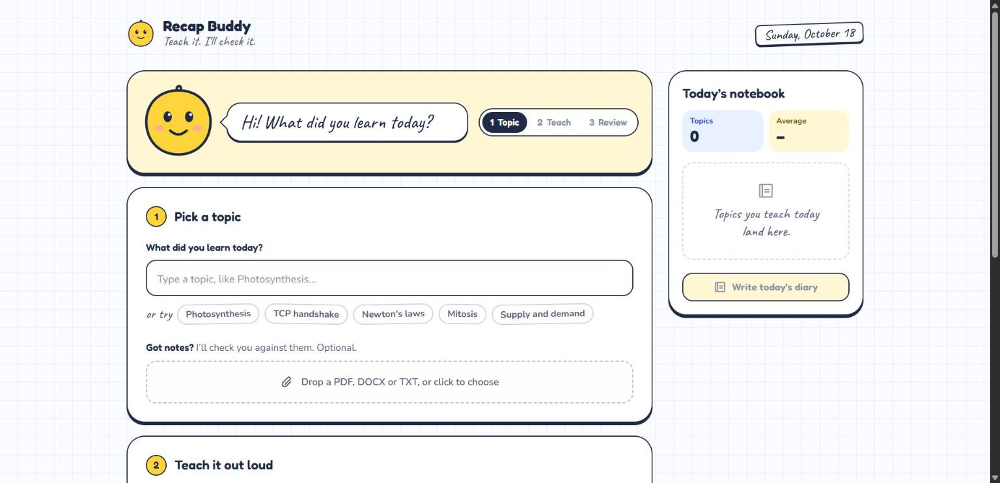
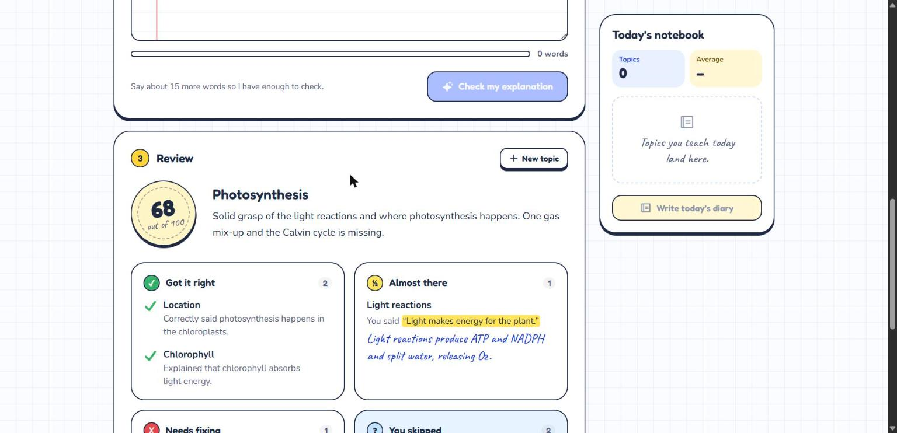
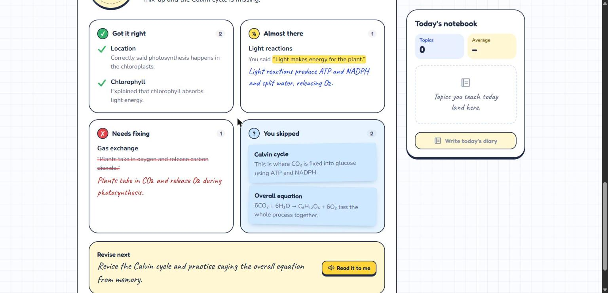
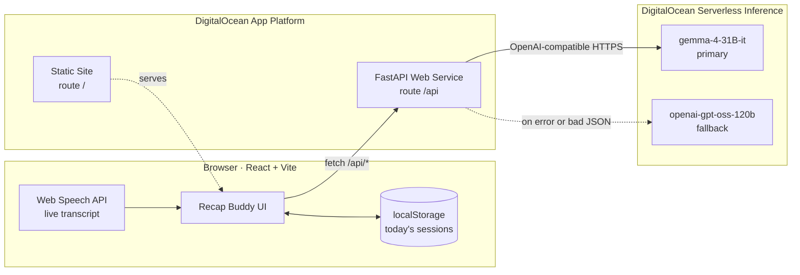

<div align="center">


# Recap Buddy

**Teach it out loud. Buddy checks it.**

An open-source study companion that listens while you explain a topic, then uses an open-weight AI model to show what you got right, what was close, what was wrong and what you missed. At the end of the day it writes up everything you learned as a diary page.

[](LICENSE)
[](https://docs.digitalocean.com/products/inference/details/models/)
[](https://www.digitalocean.com/products/app-platform)
[](https://react.dev)
[](https://fastapi.tiangolo.com)
[](https://hacktoberfest.com)

[Live demo](#) · [Demo video](#) · [Agent Skill](skills/recap-review/SKILL.md) · [Report a bug](https://github.com/Tejas-Santosh-Nalawade/Hacktoberfest-Hack-Day-ACES/issues)



</div>

---

## Contents

- [Why Recap Buddy](#why-recap-buddy)
- [Features](#features)
- [Screenshots](#screenshots)
- [How it works](#how-it-works)
- [Open-source AI](#open-source-ai)
- [Getting started](#getting-started)
- [Configuration](#configuration)
- [API reference](#api-reference)
- [Project structure](#project-structure)
- [Deploying to DigitalOcean](#deploying-to-digitalocean)
- [Agent Skill](#agent-skill)
- [Privacy](#privacy)
- [Browser support](#browser-support)
- [Roadmap](#roadmap)
- [Contributing](#contributing)
- [Acknowledgements](#acknowledgements)
- [License](#license)

## Why Recap Buddy

Many students learn best by **teaching** a concept out loud (the [Feynman technique](https://en.wikipedia.org/wiki/Learning_by_teaching)). Others revise four or five topics a day and struggle to recap them by evening. Both run into the same problem:

- There's nobody to explain the topic to.
- Even when someone listens, they usually can't say what was **correct**, what was **wrong** and what was **missed**.

Recap Buddy is that listener. It's patient, it never comments on grammar or accent, and it checks your explanation against your own notes when you have them.

## Features

| | |
|---|---|
| 🎙️ **Teach out loud** | Live speech-to-text in the browser. Words appear on a notebook page as you speak, and you can always type instead. |
| 🙂 **Buddy listens** | A mascot that nods along, moves its mouth with your real voice level, and reacts to how you did. |
| ✅ **Four-way review** | Every idea you explain lands in one of four buckets: *Got it right*, *Almost there* (with the fix), *Needs fixing* (with the correct version) or *You skipped* (with why it matters). Plus a score out of 100. |
| 📎 **Your notes as the answer key** | Upload a PDF, DOCX or TXT and the review is checked against it. Without notes, the review uses standard textbook knowledge. |
| 🧠 **Concepts only** | The model is told to ignore grammar, filler words and speech-to-text errors, and never to invent mistakes. |
| 🔊 **Read it to me** | Buddy reads the summary and what to revise next aloud. |
| 📓 **Daily diary** | One click writes a first-person diary page covering every topic from today, with a score table and your top three priorities for tomorrow. Print it or download it as Markdown. |
| 🔁 **Resilient AI** | If the primary model fails or returns broken JSON, the backend retries once on a second open-weight model. |
| 🔒 **No accounts** | Today's sessions are kept in your browser. The API key never reaches the browser. |
| ♿ **Accessible** | Keyboard focus rings, a skip link, live regions for Buddy's speech, and full respect for *reduce motion*. |

## Screenshots

<table>
  <tr>
    <td width="50%"></td>
    <td width="50%"></td>
  </tr>
  <tr>
    <td align="center"><sub>The review: a grade sticker, green ticks and highlighter fixes</sub></td>
    <td align="center"><sub>Red-pen corrections, sticky notes for missed ideas, and "Read it to me"</sub></td>
  </tr>
</table>

## How it works



1. **Pick a topic** and optionally upload notes. `POST /api/extract` pulls the text out of the PDF, DOCX or TXT.
2. **Teach it.** The browser's Web Speech API transcribes you live (`en-IN`, continuous). It restarts automatically after silences until you press stop.
3. **Check it.** `POST /api/review` sends the topic, transcript and optional notes to the model with a strict grading prompt. The backend strips code fences, extracts the JSON, validates it with Pydantic and clamps the score.
4. **Saved for today.** Each review is stored in `localStorage` under `recapbuddy:YYYY-MM-DD`.
5. **Write the diary.** `POST /api/report` turns all of today's reviews into a Markdown diary page.

The frontend and backend share one domain in production, so the frontend only ever calls relative `/api/...` paths. That means no CORS setup and no API URL to configure.

## Open-source AI

Open-weight models are the engine of the app. Without them it does nothing.

| Role | Model | Served by |
|---|---|---|
| Review and diary | **Gemma 4 31B Instruct** (`gemma-4-31B-it`, 256K context) | DigitalOcean Serverless Inference |
| Automatic fallback | **gpt-oss-120b** (`openai-gpt-oss-120b`) | DigitalOcean Serverless Inference |

- Every call uses temperature `0.2` and up to `3,000` output tokens.
- Model IDs are environment variables, so any model in the [DigitalOcean catalogue](https://docs.digitalocean.com/products/inference/details/models/) can be swapped in.
- The grading rules live in [`backend/prompts.py`](backend/prompts.py) and are published as a reusable [Agent Skill](#agent-skill).

## Getting started

### Prerequisites

- **Python** 3.11 or newer
- **Node.js** 20.19 or newer (needed by Vite 8)
- A **DigitalOcean model access key**: Control panel → **Inference** → **Model Access Keys** → **Create**. Serverless inference is prepaid from your credit balance.
- **Chrome or Edge** for voice input. Any modern browser works if you type.

### 1. Clone

```bash
git clone https://github.com/Tejas-Santosh-Nalawade/Hacktoberfest-Hack-Day-ACES.git recap-buddy
cd recap-buddy
```

### 2. Backend

```bash
cd backend
python -m venv .venv
source .venv/bin/activate          # Windows: .venv\Scripts\activate
pip install -r requirements.txt
cp .env.example .env               # then paste your key into MODEL_ACCESS_KEY
uvicorn main:app --reload --port 8000
```

Open <http://localhost:8000/docs> for the interactive Swagger UI, and check <http://localhost:8000/api/health>.

### 3. Frontend

```bash
cd frontend
npm install
npm run dev                        # http://localhost:5173
```

The Vite dev server proxies `/api` to `http://localhost:8000`, so both halves work together with no extra setup.

> [!TIP]
> Open **<http://localhost:5173/?demo>** to see a full sample review without calling the model. It's handy for UI work. Demo mode only exists in the dev build.

### Verify your key (optional)

```bash
curl -s https://inference.do-ai.run/v1/models \
  -H "Authorization: Bearer $MODEL_ACCESS_KEY" | grep -oE '"id":"[^"]*(gemma|gpt-oss)[^"]*"'
```

## Configuration

The backend reads these from the environment, or from `backend/.env` locally:

| Variable | Required | Default | Description |
|---|---|---|---|
| `MODEL_ACCESS_KEY` | Yes | none | DigitalOcean Serverless Inference key. **Never commit it.** |
| `MODEL_ID` | No | `gemma-4-31B-it` | Primary model |
| `FALLBACK_MODEL_ID` | No | `openai-gpt-oss-120b` | Used once if the primary fails or returns invalid JSON |

Limits: topic ≤ 120 characters, explanation ≥ 15 words, notes ≤ 10&nbsp;MB (text over 80,000 characters is trimmed).

## API reference

All routes live under `/api` and return JSON. Errors use FastAPI's `{"detail": "..."}` shape.

| Method | Route | Purpose |
|---|---|---|
| `GET` | `/api/health` | Status plus the models in use |
| `POST` | `/api/extract` | Extract text from an uploaded PDF, DOCX or TXT (`multipart/form-data`, field `file`) |
| `POST` | `/api/review` | Review an explanation |
| `POST` | `/api/report` | Write today's diary from a list of reviews |

<details>
<summary><strong>POST /api/review</strong>: request and response</summary>

```bash
curl -s http://localhost:8000/api/review \
  -H "Content-Type: application/json" \
  -d '{
    "topic": "Photosynthesis",
    "transcript": "Photosynthesis happens in the chloroplasts. Chlorophyll absorbs light. Plants take in oxygen and release carbon dioxide.",
    "reference": null
  }'
```

```json
{
  "topic": "Photosynthesis",
  "score": 62,
  "summary": "Good start. You know where it happens and what chlorophyll does, but the gas exchange is reversed.",
  "correct": [{ "concept": "Chlorophyll", "note": "Chlorophyll absorbs light energy." }],
  "partial": [{ "concept": "Light reactions", "what_was_said": "...", "fix": "..." }],
  "wrong":   [{ "concept": "Gas exchange", "what_was_said": "Plants take in oxygen and release carbon dioxide.", "correct_version": "Plants take in CO₂ and release O₂." }],
  "missed":  [{ "concept": "Calvin cycle", "why_it_matters": "This is where CO₂ is fixed into sugar." }],
  "next_step": "Revise the Calvin cycle.",
  "grounded": false,
  "model": "gemma-4-31B-it"
}
```

The full field reference is in [`skills/recap-review/references/schema.md`](skills/recap-review/references/schema.md).

</details>

<details>
<summary><strong>Error codes</strong></summary>

| Status | When |
|---|---|
| `400` | Unsupported file type, explanation under 15 words, or empty review list |
| `413` | Uploaded file over 10&nbsp;MB |
| `422` | File has no readable text (for example a scanned PDF), or the request body failed validation |
| `502` | Both models failed: "AI is busy, please retry" |

</details>

## Project structure

```
.
├── backend/                  FastAPI service
│   ├── main.py               /api routes
│   ├── llm.py                DigitalOcean client, fallback, JSON repair, normalisation
│   ├── prompts.py            Review and diary prompts
│   ├── extract.py            PDF / DOCX / TXT text extraction
│   ├── schemas.py            Pydantic request and response models
│   └── requirements.txt
├── frontend/                 React + Vite app
│   └── src/
│       ├── App.jsx           App state, flow and Buddy's mood logic
│       ├── api.js            Fetch helpers for /api
│       ├── storage.js        Today's sessions in localStorage
│       ├── hooks/            useSpeech (Web Speech API), useMicLevel (Web Audio)
│       ├── lib/              Confetti, speech synthesis, word count
│       └── components/       Buddy, Stepper, TopicForm, VoiceRecorder, ReviewCard, DiaryView, …
├── skills/recap-review/      Agent Skill: the grading rubric as a reusable skill
├── .do/app.yaml              DigitalOcean App Platform spec
└── docs/                     Logo and screenshots
```

## Deploying to DigitalOcean

The whole app runs as **one App Platform app with two components**, on a single HTTPS domain.

**Option A: app spec (recommended)**

```bash
doctl apps create --spec .do/app.yaml
```

Then open the app in the control panel and set `MODEL_ACCESS_KEY` on the **backend** component as an **encrypted** environment variable.

**Option B: control panel.** Go to **Create → App Platform → GitHub**, choose this repo and branch `main`, and set up:

| | `backend` (Web Service) | `frontend` (Static Site) |
|---|---|---|
| Source directory | `backend` | `frontend` |
| Run / build command | `uvicorn main:app --host 0.0.0.0 --port 8080` | `npm ci && npm run build` |
| HTTP port / output | `8080` | `dist` |
| Route | `/api`, with **Preserve path prefix** turned on | `/`, with catch-all document `index.html` |
| Health check | `/api/health` | none |
| Environment | `MODEL_ACCESS_KEY` (encrypted), `MODEL_ID`, `FALLBACK_MODEL_ID` | none |

<details>
<summary><strong>Troubleshooting</strong></summary>

| Symptom | Fix |
|---|---|
| `/api/*` returns 404 | Turn on **Preserve path prefix** for the backend route |
| Health check fails | The run command port and the HTTP port must both be `8080` |
| 502 on review | Missing `MODEL_ACCESS_KEY` or a wrong model ID. Check the backend's **Runtime Logs** |
| Page refresh returns 404 | Set the static site's catch-all document to `index.html` |
| Mic doesn't start | Use Chrome or Edge over HTTPS and allow microphone access |

</details>

> [!NOTE]
> Use Serverless Inference only. GPU Droplets and Dedicated Inference are billed by the hour and aren't needed. A review costs a fraction of a cent.

## Agent Skill

The grading rubric is published as an **[Agent Skill Open Standard](https://agentskills.io/)** skill, so any skills-compatible agent can review a learner's explanation the same way Recap Buddy does:

- [`skills/recap-review/SKILL.md`](skills/recap-review/SKILL.md): step-by-step instructions
- [`references/schema.md`](skills/recap-review/references/schema.md): the review JSON shape with a full example
- [`references/rubric.md`](skills/recap-review/references/rubric.md): what counts as correct, partial, wrong and missed, plus the 60% accuracy and 40% coverage scoring

The backend prompts implement this same skill.

## Privacy

- **No accounts and no database.** Today's sessions stay in your browser's `localStorage`, and you can delete them at any time with *Clear today*.
- Your **transcript and notes** go to the backend only to be reviewed. They are forwarded to DigitalOcean Serverless Inference and are not stored by Recap Buddy.
- Speech recognition is done by your **browser's** Web Speech API. In Chrome this uses Google's speech service.
- The model access key exists only on the server.

## Browser support

| | Chrome / Edge | Safari | Firefox |
|---|---|---|---|
| Typing, review, diary | ✅ | ✅ | ✅ |
| Voice input | ✅ | ⚠️ partial | ❌ type instead |
| Read it to me | ✅ | ✅ | ✅ |

## Roadmap

- [ ] Buddy asks one follow-up question about your weakest area
- [ ] Read-aloud feedback using a DigitalOcean text-to-speech model
- [ ] In-browser open-source Whisper for browsers without the Web Speech API
- [ ] Streaks and score history across days
- [ ] Optional web-search grounding for topics without notes

## Contributing

Contributions are welcome, and this project was born during Hacktoberfest.

1. Fork the repo and create a branch: `git checkout -b feat/your-idea`
2. Run the app locally (see [Getting started](#getting-started)) and make your change.
3. Check the frontend still builds and lints: `cd frontend && npm run build && npx oxlint src`
4. Open a pull request describing what changed and why. Add a screenshot for UI changes.

Please keep the **review JSON shape** in [`schema.md`](skills/recap-review/references/schema.md) stable. The frontend, the backend and the Agent Skill all depend on it.

## Acknowledgements

- Built at **[Hacktoberfest Hack Day Pune × ACES](https://events.mlh.io/events/15423-hacktoberfest-hack-day-pune-x-aces-association-of-computer-engineering-students)**, organised with [MLH](https://mlh.io), for the *Best Open-Source AI Project* category by [DigitalOcean](https://www.digitalocean.com).
- [Gemma](https://ai.google.dev/gemma) by Google DeepMind and [gpt-oss](https://openai.com/index/introducing-gpt-oss/) by OpenAI, both open-weight models.
- [FastAPI](https://fastapi.tiangolo.com), [React](https://react.dev), [Vite](https://vite.dev), [Tailwind CSS](https://tailwindcss.com), [Motion](https://motion.dev), [Phosphor Icons](https://phosphoricons.com), [pypdf](https://github.com/py-pdf/pypdf) and [python-docx](https://github.com/python-openxml/python-docx).
- Fonts: [Fredoka](https://fonts.google.com/specimen/Fredoka), [Nunito](https://fonts.google.com/specimen/Nunito) and [Caveat](https://fonts.google.com/specimen/Caveat).
- Developed with help from the AI coding assistant [Claude Code](https://claude.com/claude-code).

## License

Released under the [MIT License](LICENSE).
